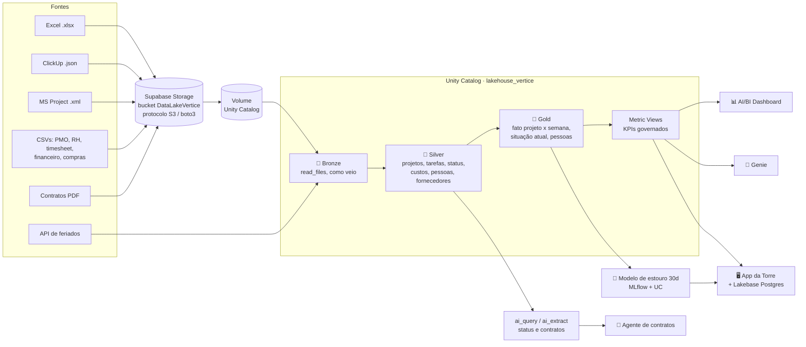
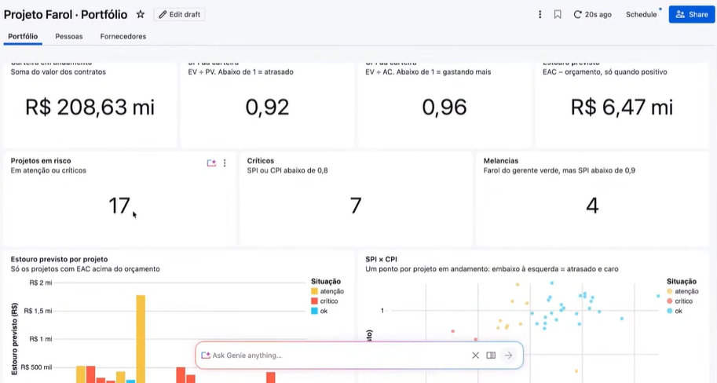
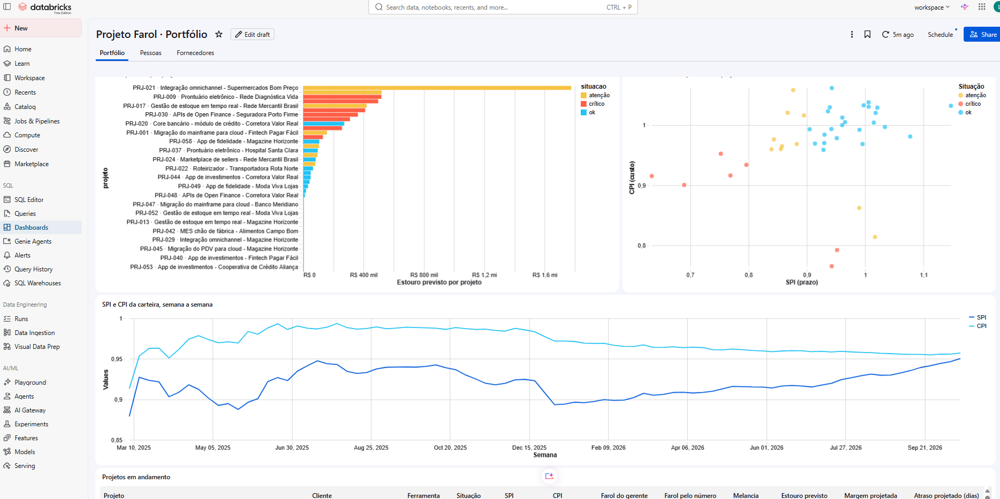
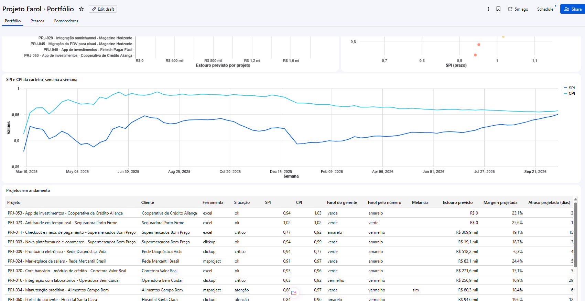
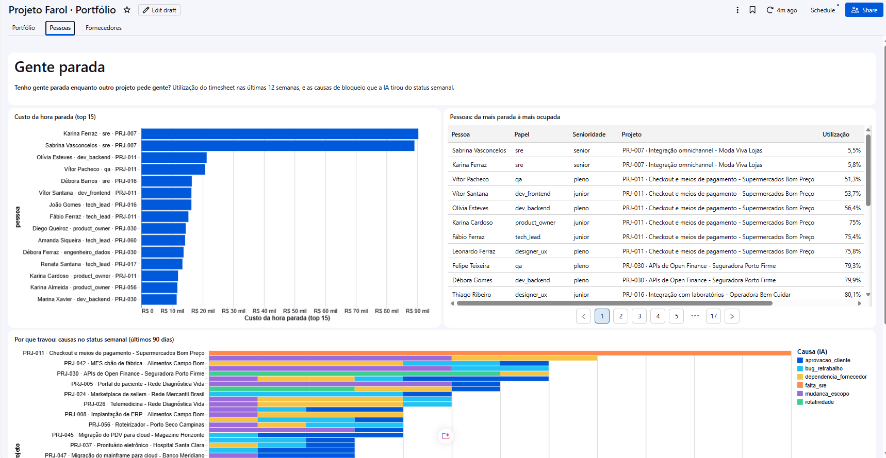
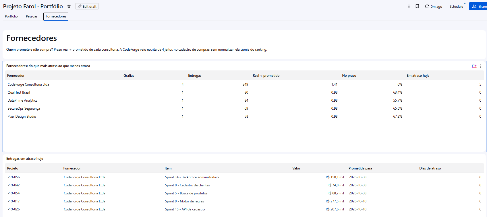
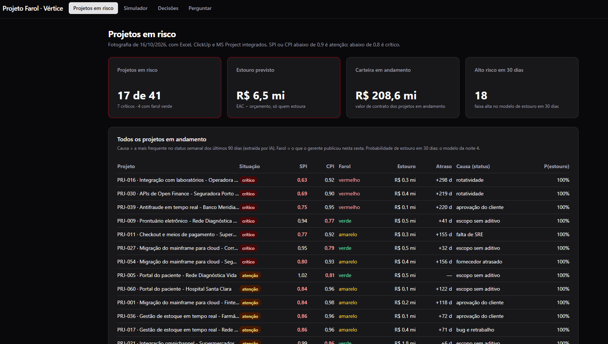
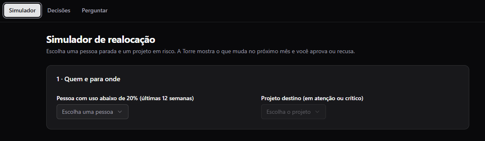
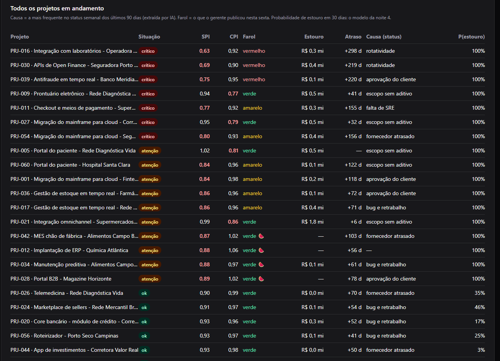

# 🗼 Torre de Controle de Projetos: Lakehouse no Databricks

> Projeto de **Data Engineering** de ponta a ponta: arquivos crus de Excel, ClickUp e MS Project viram KPIs de portfólio, um modelo de risco, um dashboard, um chat em português (Genie) e um app de decisões. Tudo no **Databricks Free Edition (serverless)**.


-3FCF8E?logo=supabase&logoColor=white)


---

## 📌 Problema de negócio

A **Vértice Tecnologia** (empresa fictícia, 520 pessoas) toca **60 projetos de clientes**, e cada gerente usa uma ferramenta: **20 em Excel, 25 no ClickUp e 15 no MS Project**. O PMO consolida tudo à mão toda sexta, e o farol do status semanal quase sempre fica verde.

O dono quer respostas para quatro perguntas:

1. Quais projetos estão atrasados, e de quais clientes?
2. Quanto esse atraso vai custar?
3. Tem gente parada enquanto outro projeto pede gente?
4. O que vai dar errado no próximo mês?

A solução é um **lakehouse medalhão** que unifica as três ferramentas num modelo só, testado e atualizado por um job diário.

---

## 🏗️ Arquitetura



**Orquestração** (job `vertice_farol`, Databricks Asset Bundle):

`ingestao_feriados` + `ingestao_data_lake` → `conferencia_bronze` → `medalhao` (pipeline Lakeflow) → `testes_de_qualidade` + `status_com_ia` → `ml_features` → `ml_modelo` → `ml_score` / `metricas_governadas`

---

## 🧰 Stack

| Camada | Tecnologia |
|---|---|
| Armazenamento / data lake | Supabase Storage (API S3), Volumes do Unity Catalog, Delta Lake |
| Ingestão | Python, `boto3`, `requests` (API), `read_files` |
| Transformação | Spark SQL, Lakeflow Declarative Pipelines |
| Orquestração / IaC | Databricks Jobs, Databricks Asset Bundles (`databricks.yml`) |
| Governança | Unity Catalog, Metric Views, lineage |
| ML | scikit-learn + MLflow (Model Registry no UC, alias `@prod`) |
| IA | `ai_query` / `ai_extract`, Genie |
| Consumo | AI/BI Dashboards, Databricks Apps (React + TypeScript + Vite), Lakebase (Postgres) |
| Dev | Databricks CLI, Claude Code, Git |

---

## 📈 KPIs

| KPI | Definição | Uso |
|---|---|---|
| **SPI** | valor agregado ÷ valor planejado | atraso de prazo |
| **CPI** | valor agregado ÷ custo real | eficiência de custo |
| **EAC / estouro previsto** | custo final projetado no ritmo atual, menos o orçamento | quanto o atraso custa |
| **Farol calculado vs. farol do gerente** | SPI/CPI < 0,9 = atenção · < 0,8 = crítico | encontra o projeto "melancia" (verde por fora, vermelho por dentro) |
| **Utilização / ociosidade** | horas apontadas vs. capacidade, por pessoa e projeto | realocar em vez de contratar |
| **Score de estouro em 30 dias** | probabilidade do modelo de ML, com o motivo | agir antes do estouro |
| **Entregas de fornecedor em atraso / multa contratual** | cruzamento das compras com cláusulas extraídas dos PDFs | cobrança de fornecedor |

### Resultados da minha execução

Números do meu workspace (Databricks Free Edition), com os **dados sintéticos** gerados por `material/gerar_dataset.py` (seed 42):

| Indicador | Valor |
|---|---|
| Carteira em andamento | **R$ 208,63 mi** |
| SPI / CPI da carteira | **0,92** / **0,96** |
| Estouro previsto | **R$ 6,47 mi** |
| Projetos em risco | **17 de 41** em andamento, sendo **7 críticos** |
| Projetos "melancia" (verde no status, vermelho no número) | **4** |
| Alto risco de estouro em 30 dias (modelo de ML) | **18** |

---

## 📂 Estrutura do repositório

```
.
├── aulas/
│   ├── aula-01-analista-sql/          # setup do catálogo, bronze em SQL, 1º dashboard e Genie
│   ├── aula-02-python-engenheiro/     # ingestão: API de feriados + data lake S3 (boto3)
│   ├── aula-03-modelagem-claude-code/
│   │   └── claude-code/vertice/       # ⭐ o bundle: databricks.yml, resources/, src/
│   │       ├── resources/             # job, pipeline, dashboard, Genie (YAML/JSON)
│   │       └── src/                   # ingestao, conferencia, silver, gold, testes, metricas, ia, ml
│   └── aula-04-produtos-de-dados-ia/
│       ├── torre-app/                 # Databricks App (React + TS) + Lakebase
│       └── bonus/agente/              # agente de contratos (Genie)
├── material/gerar_dataset.py          # gera o dataset sintético (seed 42, reprodutível)
├── scripts/                           # utilitários (run_sql, genie, geração de notebooks)
└── docs/img/portfolio/                # prints da minha execução
```

---

## ▶️ Como reproduzir

**Pré-requisitos:**

- Conta grátis no [Databricks Free Edition](https://www.databricks.com/learn/free-edition)
- [Databricks CLI](https://docs.databricks.com/dev-tools/cli/install.html) ≥ 0.250
- Git
- Node.js LTS (só para o app)
- Um bucket S3-compatível. Eu uso o Supabase Storage.

**1. Clonar e autenticar**

```bash
git clone https://github.com/LucasMalessa/torre-de-controle-databricks.git && cd torre-de-controle-databricks
databricks auth login --profile imersao
```

**2. Bronze (noite 1, no navegador)**

1. No workspace: **Create → Git folder**, apontando para este repositório.
2. Rode `aulas/aula-01-analista-sql/00-carregar-dados` (cria o catálogo `lakehouse_vertice` e gera os dados no Volume).
3. Rode `01-ingestao-bronze.sql` e depois `99-verificacao.sql` (todas as linhas devem dar `ok`).

**3. Data lake no Supabase (opcional, noite 2)**

1. Crie o bucket `DataLakeVertice` e suba os arquivos de `dados/`, que são gerados por `material/gerar_dataset.py`.
2. Gere as chaves S3 em *Project Settings → Storage → S3 access keys*.
3. Guarde as chaves num **Databricks Secret scope** (uma vez só; o job lê de lá, nunca de parâmetro):

```bash
databricks secrets create-scope vertice -p imersao
databricks secrets put-secret vertice s3_access_key_id     --string-value "<SUA_ACCESS_KEY_ID>"     -p imersao
databricks secrets put-secret vertice s3_secret_access_key --string-value "<SUA_SECRET_ACCESS_KEY>" -p imersao
databricks secrets list-secrets vertice -p imersao   # mostra só os nomes
```

**4. Deploy do bundle (noites 3 e 4)**

```bash
cd aulas/aula-03-modelagem-claude-code/claude-code/vertice
databricks bundle validate -p imersao
databricks bundle deploy  -p imersao
# warehouse_id, s3_endpoint e s3_regiao já têm default no databricks.yml (meu workspace e meu Supabase, us-east-1).
# Para usar outro workspace: --var="warehouse_id=<id>"; outro bucket: --var="s3_endpoint=https://<project-ref>.storage.supabase.co/storage/v1/s3" --var="s3_regiao=<regiao>"
databricks bundle run vertice_farol -p imersao
```

> 🔐 **Segredos:** as chaves S3 ficam no secret scope `vertice` (`s3_access_key_id`, `s3_secret_access_key`) e o notebook `02_ingestao_boto3.py` lê com `dbutils.secrets.get`. O scope é configurável pela variável do bundle `secret_scope` (default `vertice`). Nenhuma chave vai para o código, para o bundle ou para os parâmetros do job.

**5. App da Torre (opcional)**

```bash
cd aulas/aula-04-produtos-de-dados-ia/torre-app
cp .env.example .env      # preencha DATABRICKS_HOST, DATABRICKS_WAREHOUSE_ID, DATABRICKS_GENIE_SPACE_ID, PG*/LAKEBASE_*
npm install
databricks bundle deploy -p imersao
```

---

## 🖼️ Prints

Prints da minha execução, feitos com os dados sintéticos (seed 42).

### Dashboard AI/BI (Lakeview)

| | |
|---|---|
|  <br/> *Portfólio: carteira, SPI, CPI, estouro e farol* |  <br/> *Estouro por projeto, SPI × CPI e série semanal* |
|  <br/> *Série SPI/CPI e projetos em andamento* |  <br/> *Pessoas: gente parada, custo da hora parada e causas apontadas pela IA* |
|  <br/> *Fornecedores: entregas em atraso* | |

### App Farol (Databricks Apps + Lakebase)

| | |
|---|---|
|  <br/> *Projetos em risco: 17 de 41, estouro de R$ 6,5 mi* |  <br/> *Simulador de realocação de pessoas* |
|  <br/> *Projetos com a probabilidade de estouro em 30 dias* | |

O app roda no **Databricks Apps**, guarda as decisões no **Lakebase** (Postgres gerenciado) e lê a gold pelo service principal do app, com GRANT só de leitura. As chaves do data lake ficam no **secret scope** `vertice`.

---

## 🛠️ Minhas contribuições

- [x] **Data lake próprio:** bucket `DataLakeVertice` no meu Supabase, com endpoint e região passados como variáveis do bundle, sem nada hardcoded
- [x] **Segredos no Databricks Secret scope:** as chaves S3 saíram dos parâmetros do job (onde ficavam visíveis na definição) e passaram a ser lidas com `dbutils.secrets.get` do scope `vertice`
- [ ] **CI:** GitHub Actions rodando `databricks bundle validate` a cada PR
- [ ] TODO: melhoria no modelo de dados / novo teste de qualidade
- [ ] TODO: novo KPI ou visão no dashboard
- [ ] TODO: documentação / diagrama / ajustes para rodar no Windows

---

## 🎓 O que aprendi

- Ingestão de fontes heterogêneas (xlsx, JSON aninhado, XML) e data lake S3 com `boto3`
- Arquitetura medalhão e modelagem de fato "projeto × semana" (a diferença entre fotografia e filme)
- Testes de qualidade de dados dentro do pipeline
- Infra como código com **Databricks Asset Bundles**: variáveis, targets dev/prod, segredos fora do Git
- Orquestração de um DAG com dependências entre ingestão, transformação, IA e ML
- Governança com Unity Catalog e KPIs definidos uma vez (Metric Views)
- Ciclo de ML com MLflow e cuidados com vazamento de dados (data leakage)
- Uso de IA generativa (Claude Code, `ai_query`) como ferramenta de engenharia
- TODO: aprendizados pessoais

---

## 🙏 Créditos

Este projeto foi construído durante a **Imersão Databricks + Claude Code**, da **[Jornada de Dados](https://suajornadadedados.com.br/)**, com o professor **Luciano Galvão**.
Repositório original: **[lvgalvao/ImersaoControlTower](https://github.com/lvgalvao/ImersaoControlTower)**.
O case, o dataset sintético e o material didático são do curso. As adaptações e a execução listadas em *Minhas contribuições* são minhas.

## 👤 Autor

**Lucas Malessa**: Data Analyst → Data Engineer
[LinkedIn](https://www.linkedin.com/in/lucasmalessa/) · [GitHub](https://github.com/LucasMalessa)
